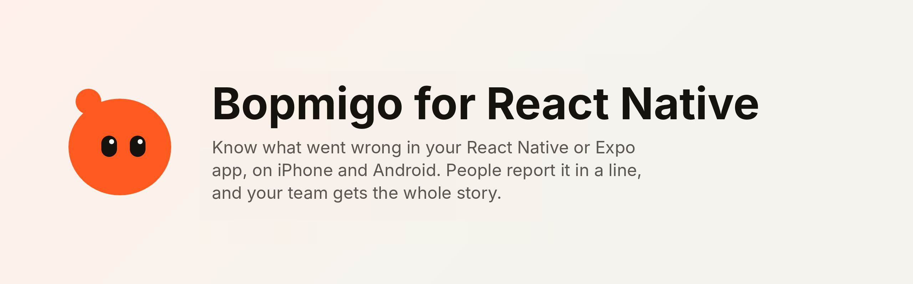
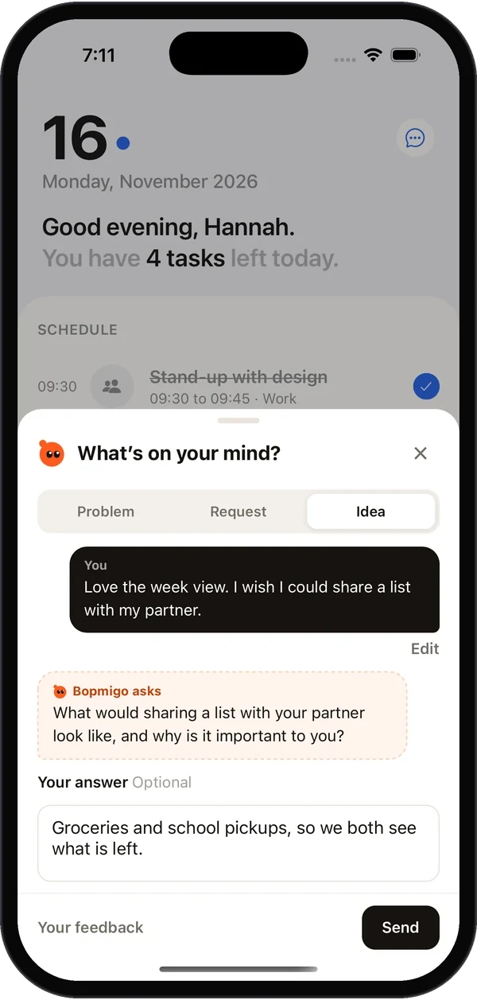
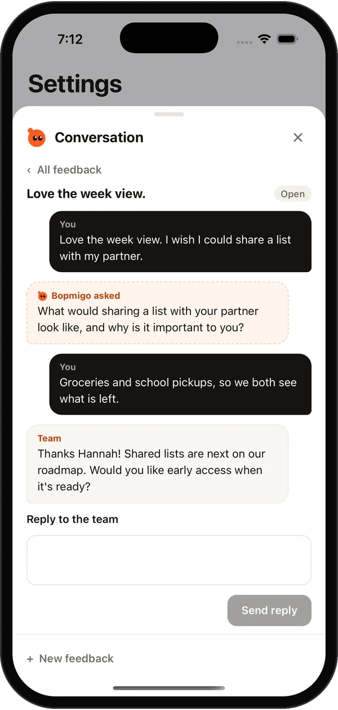
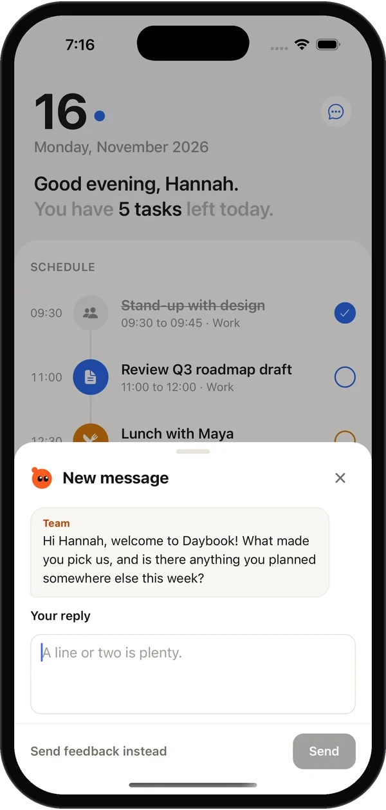

<p align="center"></p>

<p align="center">
  <a href="https://www.npmjs.com/package/bopmigo-react-native"></a>
  
  
  <a href="LICENSE"></a>
</p>

# Bopmigo for React Native and Expo

Know what went wrong in your React Native or Expo app, on iPhone and Android. People report it in a line or two, and your team gets the whole story, with a short follow-up if something important is missing.

Reports arrive in your [Bopmigo](https://bopmigo.com) inbox, or in your email if you prefer. When you reply, they see it in your app and can answer back. You can also message someone first.

## How it works

<table>
<tr>
<td width="33%" valign="top"><br><b>1. Report in the moment</b><br>People tap Feedback, or your own button, and write a line. If something is unclear, Bopmigo asks a short follow-up. They can always skip it.</td>
<td width="33%" valign="top"><br><b>2. Reply from your inbox</b><br>Your reply shows up in the app, and they can answer back.</td>
<td width="33%" valign="top"><br><b>3. Or message them first</b><br>Ask a question at the right moment. It opens the next time they're in the app.</td>
</tr>
</table>

<sub>Screens from Daybook, the sample app in <code>example/</code>, running in the iOS Simulator.</sub>

## Requirements

React Native 0.72 or later, or Expo. Works in Expo Go, Expo development builds and bare React Native.

## Install

```sh
npx expo install bopmigo-react-native @react-native-async-storage/async-storage
```

`@react-native-async-storage/async-storage` keeps the conversation and any unsent report when the app restarts. To attach a picture of the screen to reports, also install `react-native-view-shot` and turn on `screenshots` below. Both are optional and both are included in Expo Go.

## Set up

```tsx
import Bopmigo, { BopmigoProvider } from 'bopmigo-react-native';

Bopmigo.configure({
  appId: 'YOUR_APP_ID',      // In Bopmigo: your app, then Project settings
  release: '2.4.1 (310)',    // Optional: your app version, shown with each report
  screenshots: false,        // Optional: attach a picture of the screen to reports
});

export default function App() {
  return (
    <BopmigoProvider>
      <YourApp />
    </BopmigoProvider>
  );
}
```

That adds a Feedback button in the corner. Prefer your own menu item? Use `<BopmigoProvider button={false}>` and call `Bopmigo.open()`.

## Who is signed in

```ts
Bopmigo.identify({ id: user.id, email: user.email, name: user.name });
Bopmigo.setContext({ plan: 'pro', team: 'Studio' });  // Your own details, shown on the person
Bopmigo.identify(null);                                // On sign-out
```

Identifying people lets your team see who wrote, and send them messages. When someone else signs in on the same phone, they start a fresh conversation and never see the last person's, even after the app restarts.

## Which screen

```ts
Bopmigo.setScreen('Checkout');
```

With Expo Router:

```tsx
const path = usePathname();
useEffect(() => { Bopmigo.setScreen(path); }, [path]);
```

## Open it from anywhere

```ts
Bopmigo.open();                                         // Continue or start feedback
Bopmigo.open({ type: 'problem' });                      // 'problem', 'change' or 'idea'
Bopmigo.open({ type: 'idea', message: 'How was your first week?' });  // Your own question above the box
Bopmigo.showReplies();                                  // Past feedback and your team's replies
```

## Replies and messages

Replies from your inbox and messages your team starts show in the sheet. The Feedback button changes to "New reply" or "New message". To show your own badge:

```ts
useEffect(() => Bopmigo.on('unread', ({ replies, messages }) => setBadge(replies + messages)), []);
```

A message your team marks "Open automatically" opens the sheet the next time the person is in the app.

## How replies reach people

While the app is open:

- **Checking:** the package checks for replies when the app opens, when it comes back to the front, and every minute.
- **Button:** the Feedback button changes to "New reply" or "New message", with an orange dot, and Migo gives a small wave every few seconds (still when Reduce Motion is on).
- **Your own badge:** use `Bopmigo.on('unread', …)` to show a count anywhere, such as a Settings tab.
- **Open conversation:** a reply shows up within about 5 seconds while the person is reading it.
- **Open automatically:** a team message sent with "Open automatically" opens the sheet by itself the next time the app checks.

When the app is closed, nothing reaches the person until they open it again.

## Offline

A report written without a connection is kept on the phone and sent the next time the app is open and online.

## Example

`example/` is Daybook, a small day planner built with Expo Router. Put your app ID in `example/.env`:

```
EXPO_PUBLIC_BOPMIGO_APP_ID=your-app-id
```

Then `cd example && npm install && npx expo start`. There is no sign-in: each install gets its own sample person, so testers show up separately in your inbox. Tick off a task for the first time and Daybook asks how it went, using `Bopmigo.open({ message })`.

## What is sent

Bopmigo sends what the person writes, the screen name, app version, device, system version, language, time zone and the details you pass to `identify` and `setContext`. Screen pictures are only taken when you turn on `screenshots`.

## Docs

[bopmigo.com/docs/add-in-app-feedback-to-react-native-app](https://bopmigo.com/docs/add-in-app-feedback-to-react-native-app)

## License

MIT
